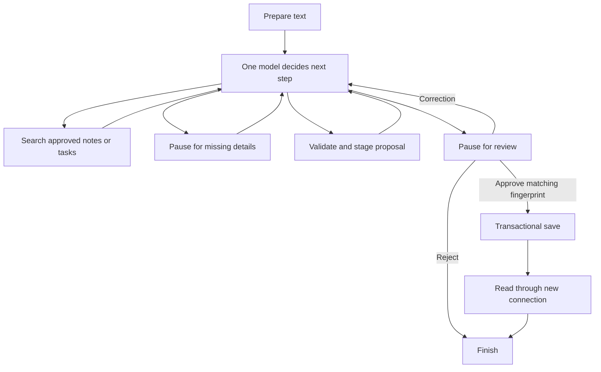

# Working Mom’s Buddy

An AI assistant that helps busy working parents turn family
notes and school notices into organized, approved tasks.

## Planned Features
- Capture family information through text, with voice input planned.
- Search saved notes and existing tasks.
- Ask for clarification when important details are missing.
- Request approval before saving changes.
- Handle tool failures and prevent duplicate tasks.

## Technology
Python, LangChain, and LangGraph.

## Project Status
Milestone 1 implements a text notice workflow with clarification, review,
correction/rejection, approval, persistent save, and retrieval tools.
The offline workflow is verified. Nebius account access and a live tool-call
probe have passed. The user approved the first live notice; one note and two
tasks were saved, read back in another process, and matched to the approved
fingerprint. Live retrieval now returns the correct deadline with saved-source
evidence, and an empty-store query reports no matching information. A corrected
date was approved and saved with a new matching fingerprint. Live rejection
preserved zero confirmed records even when notice text claimed automatic
approval. A repeatable live evaluation also verified full-date capture and an
unchanged database after a duplicate save. Injected live tool failures verified
one-retry read recovery and a safe stop after two failed write attempts.
All ten defined live scenario checks have passing final outcomes after the
documented fixes; 29 automated tests pass. The live evaluators use fictional
data, simulated review where indicated, and injected faults for recovery tests.
This is a local terminal learning project. A 4:28 narrated demo video has been
generated locally from actual app output. The Google Doc, review/upload of that
video are the remaining submission work. Code and documentation are maintained
in [the GitHub repository](https://github.com/Vijayshree85/working-moms-buddy).

## Setup

For a fresh clone, open a terminal at the repository root and use these
**Windows Command Prompt commands** with Python 3.14.5:

```bat
python -m venv .venv
.venv\Scripts\activate.bat
python -m pip install -r requirements.lock.txt
python -m buddy run --practice
```

Practice is offline. Live use requires `.env` configuration as described below.

### Current local workspace

The actual Git repository is currently nested one level below the VS Code
workspace. Keep application files here, beside this README and `.git`.
The existing virtual environment and original PDFs are in the parent folder.

```text
C:\codebase\GenAcademy\Week3\working-moms-buddy\  (workspace)
  .venv\
  docs\                                        (original course PDFs)
  working-moms-buddy\                           (Git repository; run here)
    .gitignore
    README.md
    buddy\
    docs\                                      (project notes and iteration log)
    tests\
```

**Terminal commands — Windows Command Prompt**, starting from the workspace:

```bat
cd /d C:\codebase\GenAcademy\Week3\working-moms-buddy
.venv\Scripts\activate.bat
cd working-moms-buddy
python -m pip install -r requirements.lock.txt
python -m pip check
```

The current `.venv` already has the dependencies installed. Activation changes
which Python the terminal uses; it does not install dependencies. In PowerShell,
you can use `..\.venv\Scripts\python.exe` in place of `python` from this folder.
No PowerShell execution-policy change is needed.

Dependencies were resolved, installed, imported, and tested on Windows with
CPython **3.14.5**. `requirements.txt` explains the direct dependencies;
`requirements.lock.txt` pins the full environment used by this milestone.

## Try one fictional notice without a key

**Terminal command:**

```bat
python -m buddy run --practice
```

This fixed example deliberately omits the year:

> Maya's class field trip is November 6. Bring packed lunch.
> Return the consent form by November 3.

1. Enter `2026` when asked for the year.
2. Read the complete proposed notice, two tasks, source text, and clarification.
3. Enter `approve` to confirm it, `reject` to discard it, or `edit` to correct it.
   For practice, a supported correction is `Consent is due 2026-11-04`.
4. After editing, review the new proposal and approve it separately.
5. A successful save shows the note ID and a record read through a new SQLite
   connection. Run the same example again to check duplicate prevention.

Practice mode uses a **scripted model substitute**. The tools, LangGraph pause,
checkpoints, and SQLite saves are real; the model reasoning is simulated. It
recognizes this fixed notice, a four-digit year, and an ISO consent-date
correction. Use live mode for general notices and questions. Practice records
are isolated in `data/practice`; live records use `data/live`.

Enter `quit` at either prompt to leave the request paused. Copy the session ID
printed when it starts.

**Terminal command — replace the placeholder with your session ID:**

```bat
python -m buddy run --practice --resume YOUR_SESSION_ID
```

To verify the confirmed record in another process, copy the saved note ID:

```bat
python -m buddy show YOUR_NOTE_ID --data-dir data/practice
```

## Connect Nebius for real model decisions

The provider and model remain provisional. The current adapter uses Nebius
Token Factory's compatible chat API. A model appearing in an account's catalog
does not by itself prove that tool calling or inference works.

**Terminal command:**

```bat
copy .env.example .env
```

**File contents — edit `.env` locally**, using your own key:

```dotenv
NEBIUS_API_KEY=YOUR_LOCAL_KEY
NEBIUS_MODEL=
NEBIUS_BASE_URL=https://api.tokenfactory.nebius.com/v1/
```

`.env` is ignored by Git. The app reads it from this repository folder, without
overwriting existing environment variables. Do not paste the key into chat or
record it in your demo. Do not overwrite an existing `.env` with the copy command.

**Terminal commands:**

```bat
python -m buddy doctor --list-models
```

Choose an exact model ID from that account's list and set `NEBIUS_MODEL` in
`.env`, then run:

```bat
python -m buddy doctor --probe
python -m buddy run --text "Maya's class field trip is November 6. Bring packed lunch. Return the consent form by November 3."
```

The probe makes a small inference request and validates a returned tool call.
It does not execute a write or check the remaining credit balance. The doctor
prints credential presence, never the key. On October 25, 2026, the account
catalog returned 30 models and a live tool-call probe passed using
`Qwen/Qwen3-30B-A3B-Instruct-2507`, now selected provisionally in the local `.env`.
A first live notice correctly requested the missing year and proposed two tasks,
then paused for review without saving confirmed records. The user subsequently
approved it; one note and two tasks persisted and the stored content matched its
approved fingerprint. All ten defined live scenarios now have passing final
outcomes after documented fixes; see the evaluation evidence below. Offline
results and live-model results are recorded separately.

After saving a live notice, ask a question:

```bat
python -m buddy run --text "When is the consent form due?"
```

The agent chooses a retrieval tool. The terminal displays retrieved record IDs
and original text alongside the answer. Search matches whole-word keywords
across the saved text, handles possessive names and ignores common question
words such as “when” and “due.” All descriptive keywords must match; task lookup
prefers matches in task text. There is no embedding or vector database, and
synonyms and paraphrases are not guaranteed matches.

## How the components fit together

| Component | What it does | Why this milestone needs it |
| --- | --- | --- |
| `buddy/models.py` | Prepares input and validates notice/task contracts | Like validated C# DTOs; keeps malformed drafts out of review |
| `buddy/agent.py` | Defines one agent, its tools, and request state | Lets the model choose retrieval or clarification while code enforces approval |
| LangGraph checkpointer | Saves graph state and pending review interrupts | Lets a terminal process stop and resume the same request |
| `buddy/storage.py` | Saves approved records in one SQLite transaction | Persists across sessions and prevents partial or repeated saves |
| `buddy/provider.py` | Loads environment settings and checks Nebius | Keeps credentials separate and checks real account capabilities |
| `buddy/__main__.py` | Displays questions, proposals, and results | Provides the smallest usable interface for text input |
| `buddy/practice.py` | Supplies a fixed fictional model substitute | Allows learning and workflow checks before credentials are configured |
| `buddy/evaluate_duplicates.py` | Runs opt-in live full-date and duplicate checks | Tests real model/tool behavior with simulated review on isolated fictional data |
| `buddy/evaluate_failures.py` | Injects temporary read and persistent write failures | Verifies bounded retry, grounded recovery and safe termination with the real model |
| `buddy/evaluate_restart.py` | Runs clarification, review, approval and read-back in four CLI processes | Verifies missing-deadline handling and checkpoints across process exits |

LangChain's `create_agent` builds the LangGraph model/tool loop. Five tools and
several graph nodes still form **one agent**.



The model cannot supply approval arguments to the write tool. The terminal
resumes a LangGraph interrupt with the human's decision and the displayed
proposal fingerprint. Corrections invalidate the old proposal. The write reads
the staged content directly; there is no model call between approval and save.
Human replies also become the latest human messages for the agent. Corrections
take priority over old dates; changed tasks can quote the exact correction as
evidence. If a quote is invented, validation returns available source text for
repair. Review shows a concise task/date summary before the full source record.

`sessions.sqlite3` contains local **unconfirmed drafts and conversation state**
so pausing works. `family.sqlite3` contains confirmed notes and tasks. “Zero
unapproved writes” means zero unapproved **confirmed family records**; drafts
are checkpointed before approval. Both databases are excluded from Git.

## Verify the milestone

**Terminal commands:**

```bat
python -m unittest discover -s tests -v
python -m pip check
```

See [the ten scenarios](docs/test-scenarios.md),
[project and learning notes](docs/project-notes.md), and
[the AI coding/iteration log](docs/ai-coding-log.md).

An optional evaluation checks two real-model capture requests in a fresh
isolated database. It validates each proposal before supplying a simulated
reviewer approval; the second attempt must return the first note without
changing any rows or IDs. This uses the configured Nebius model and fixed
fictional data. It is separate from the offline test suite.

**Terminal command:**

```bat
python -m buddy.evaluate_duplicates
```

See [the recorded live evaluation](docs/live-duplicate-check.json).

An additional opt-in evaluation injects SQLite connection failures while using
the real model and existing retry logic. A temporary read must recover with a
source-backed answer; a persistent approved write must stop after two attempts
and leave zero records. It uses fixed fictional data, simulated test review and
fresh isolated folders.

**Terminal command:**

```bat
python -m buddy.evaluate_failures
```

See [the recorded failure evaluation](docs/live-failure-check.json).

The final opt-in evaluation launches four fresh CLI processes: pause for a
missing deadline, resume with a simulated reply and pause for review, approve a
checked proposal, then independently read the saved record. It uses a fresh
isolated folder and the configured live model.

**Terminal command:**

```bat
python -m buddy.evaluate_restart
```

See [the recorded restart evaluation](docs/live-restart-check.json),
[the Google Doc content draft](docs/submission-draft.md), and
[the demo and submission guide](docs/demo-guide.md).

The generated narrated video is at `artifacts/working-moms-buddy-demo.mp4`
(4:28, 1080p). It uses actual app output, scripted fictional inputs and synthetic
narration. See [video details](docs/video-artifact.md). Generated media is ignored
by Git; upload the reviewed video separately for its submission link.

## Current limits

- This milestone requires a full event date and a due date for every task.
  Unknown years require clarification; undated tasks are a later addition.
- Duplicate protection recognizes the same normalized source and event date,
  with the same task titles/dates. Semantic paraphrases of a notice are not
  guaranteed duplicates. Different tasks for an already-saved notice produce a
  conflict rather than modifying records; editing saved records is later work.
- SQLite operations get two attempts, provider requests allow one retry, and a
  graph invocation is limited to 24 steps. Clarification allows three rounds.
  A save whose read-back fails is reported as unverified; retrying the same
  notice is safe against repeated inserts.
- The ten defined live scenarios have passing final outcomes after fixes. This
  does not establish reliability on arbitrary notices. Review dates, tasks and evidence.
- Voice, images/PDF inputs, external calendars, meals, multiple agents, MCP,
  Mem0, and knowledge graphs remain outside this milestone.
